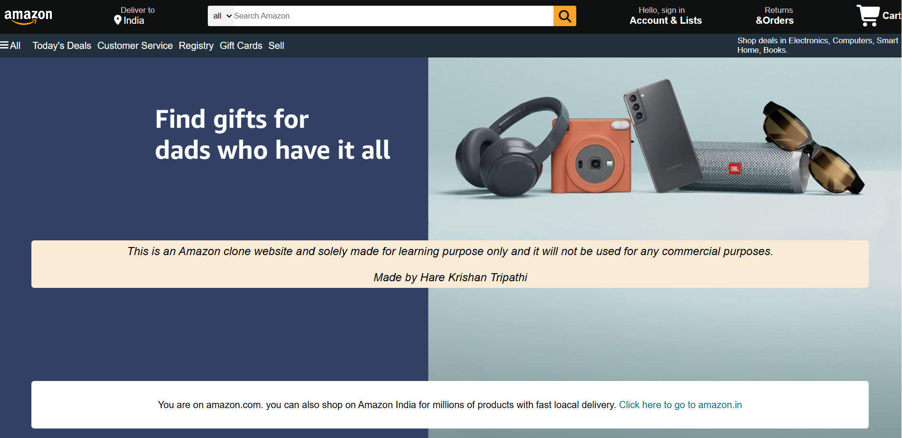
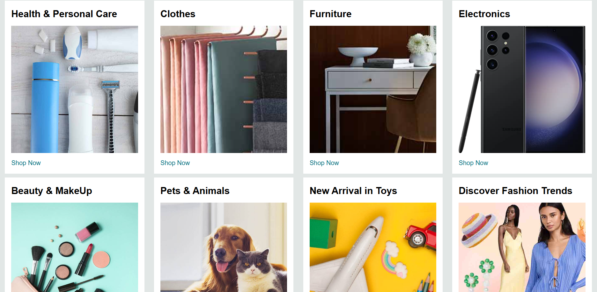

# Amazon Clone

A simple Amazon-inspired website made to practice building a real website layout.

This is a learning project and is not affiliated with Amazon or intended for commercial use.

---

## Preview

---

## What's included

- Responsive homepage with Amazon-style navigation and a hero banner
- Category cards that open their own pages in a new tab
- Sample products and prices for each category
- Product search, category selection, price and rating filters, and sorting
- A shopping cart saved in the browser
- A demo sign-in and sign-up flow
- All project images stored in the `images` folder

The clone now uses JavaScript and has functional front-end features. It does **not have a backend**: products are sample data, and the cart and demo account only work in the current browser. The sign-in flow is for learning only and is not secure authentication for real accounts.

---

## Built with

- HTML
- CSS
- JavaScript
- Font Awesome icons

---

## How to run it

Open `index.html` in a browser. No setup is needed.

---

## What I'm still learning / improving

- Connecting the project to a backend
- Adding unique images for each sample product
- Improving the shopping and account experience

---

## About

Made by **[Hare Krishan Tripathi]** while learning web development.
